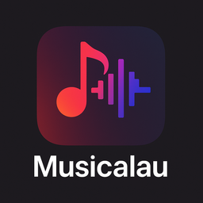
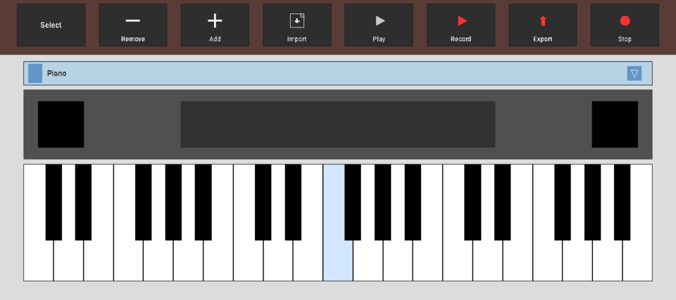
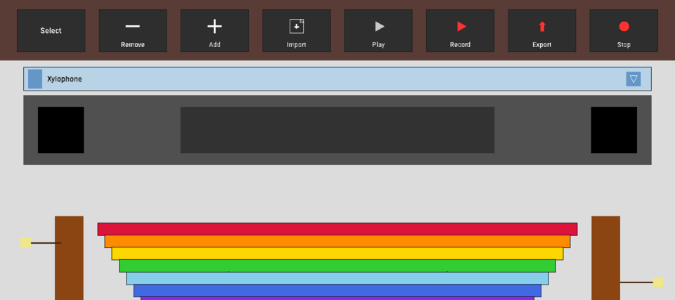
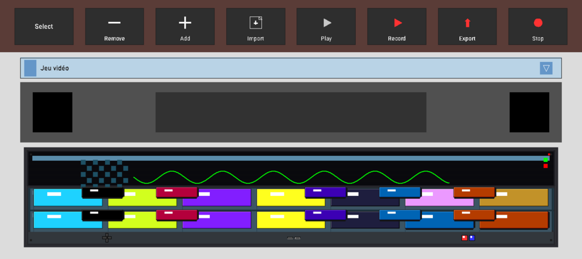

<p align="center">
  
</p>

<h1 align="center">MusicaLau</h1>

<p align="center">
  A desktop app for playing virtual instruments, with <b>all sounds synthesized in real time</b>. Written in C++17 with SDL3.
</p>

<p align="center">
  <a href="../../actions/workflows/build.yml"></a>
  
  
  
</p>

<p align="center">
  
  
  
</p>

## About

MusicaLau was built as a team project at engineering school (JUNIA ISEN, January–May 2025), answering a brief
from a fictional music store, *MusicaLau*. The store wanted an affordable, space-saving alternative to physical
instruments that its customers could use to play, record and replay music ([client brief, in French](docs/client-brief.pdf)).

The main technical constraint was that **every sound had to be generated by the application itself**: there are no audio
samples. Each instrument is an oscillator with its own waveform and envelope, mixed in an SDL audio callback.

## Features

- **Three instruments**, switchable from a dropdown:
  - **Piano**: adjustable number of octaves (minimum 2) with the `–` / `+` buttons
  - **Xylophone**: bright tone with a fast decay
  - **8-bit "video game"**: chiptune square/pulse waves
- **Real-time audio synthesis**: continuous phase oscillators, ADSR-style envelopes, polyphony and stereo
  crossfading so notes start and stop without clicks
- **Mouse and keyboard play**, with visual feedback on hover and press (on the xylophone and 8-bit instrument, velocity depends on where you click)
- **Song player**: import a score file (`.txt`) and play it back on the current instrument, with pause and resume.
  Playback runs on a separate thread so the UI stays responsive

### Keyboard controls

Bindings follow an **AZERTY** layout (one octave plus three notes):

| Keys | `Q` | `Z` | `S` | `E` | `D` | `F` | `T` | `G` | `Y` | `H` | `U` | `J` | `K` | `L` | `M` |
|------|-----|-----|-----|-----|-----|-----|-----|-----|-----|-----|-----|-----|-----|-----|-----|
| Note | C4  | C#4 | D4  | D#4 | E4  | F4  | F#4 | G4  | G#4 | A4  | A#4 | B4  | C5  | D5  | E5  |

`Esc` quits the application.

### Score file format

One event per line: a note name (scientific pitch notation) or `0` for a rest, followed by a duration in seconds.

```text
A#1 0.125
0   0.1625
C5  0.083
```

Example songs are in [`songs/`](songs/).

## Building

You need **CMake ≥ 3.20** and a **C++17 compiler** (MSVC, MinGW, GCC or Clang).
CMake uses SDL3 and SDL3_ttf if they're installed on your system, and **otherwise downloads and builds them
automatically**, so you don't have to install anything else.

```bash
git clone https://github.com/Arno-Dubois/MusicaLau.git
cd MusicaLau
cmake -S . -B build -DCMAKE_BUILD_TYPE=Release
cmake --build build --config Release
```

Then run `build/bin/MusicaLau` (`build\bin\MusicaLau.exe` on Windows). The fonts, example songs and, on Windows,
SDL DLLs are copied next to the executable.

> On Linux, building SDL from source requires the usual development headers (X11/Wayland, PulseAudio/ALSA). On
> Debian/Ubuntu you can skip that by installing `libsdl3-dev libsdl3-ttf-dev`.

To print debug traces to the console, configure with `-DMUSICALAU_DEBUG=ON`.

A prebuilt Windows version is available on the [Releases](../../releases) page.

## Architecture

The code follows an **MVC** structure, with a separate audio layer:

```
include/ & src/
├── Application        Main loop, window, event dispatch, instrument switching
├── Model/             Instrument state and layout (Piano, Xylophone, VideoGame)
├── View/              SDL rendering of each instrument and of the toolbar
├── Controller/        Input handling per instrument, toolbar buttons, file import
├── Audio/             SDLAudioEngine (synthesis + mixing), SongPlayer (threaded playback), score parser
├── Core/              Note and Instrument abstractions shared by the audio layer
├── Instruments/       Synth voices for each instrument
└── Utils/             Text rendering, dropdown menu, logging
```

The design was prepared before coding with a [Figma mock-up](https://www.figma.com/design/3jnXtgSgYHLTXJVh9uZIyi/MusicaLau?node-id=0-1&p=f&t=LPc8LlkOwBIpgue4-0)
and a UML model ([`docs/MusicaLau-UML.vpp`](docs/MusicaLau-UML.vpp), Visual Paradigm).

## Roadmap

- [ ] Record what the user plays and export it as a score file (the toolbar buttons are already in place)
- [ ] More instruments (a guitar voice already exists in the audio layer)
- [ ] Unit tests for the score parser and the synthesis engine

## Authors

- **Arno Dubois** ([@Arno-Dubois](https://github.com/Arno-Dubois))
- **Corentin Gambier** ([@corentingmbr](https://github.com/corentingmbr))
